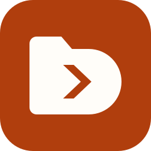
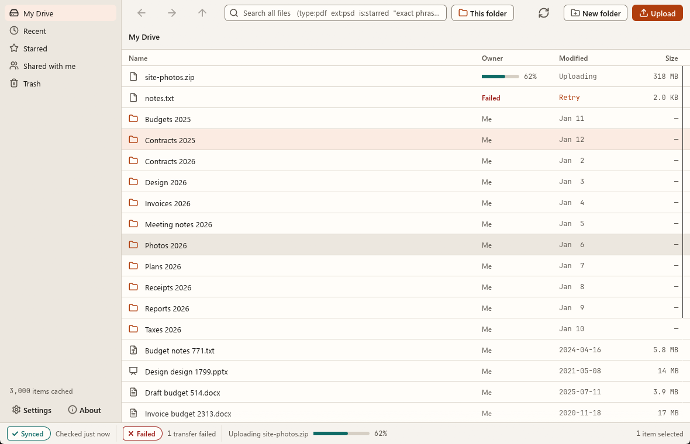
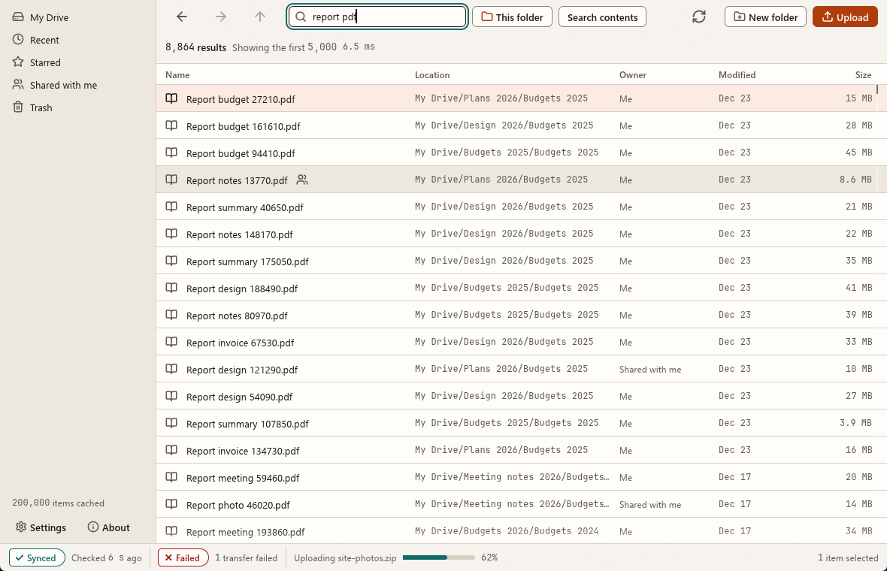
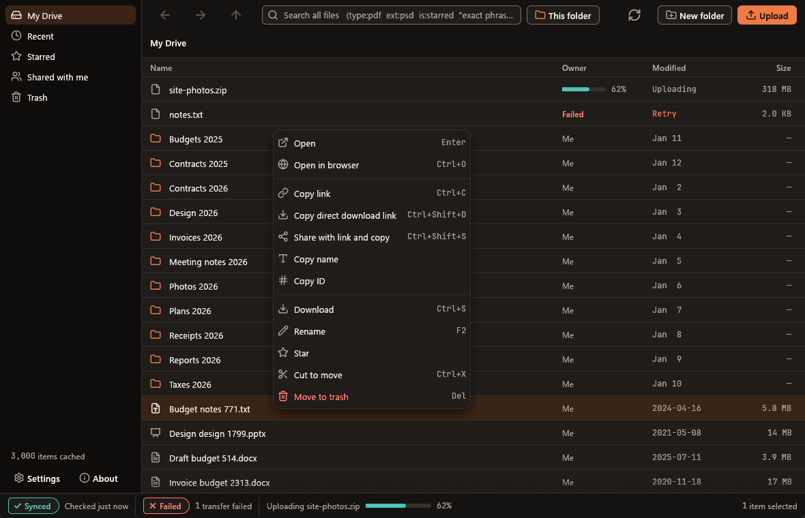

# Dray

A fast, native desktop client for Google Drive.

Dray keeps a local index of your whole Drive, so finding a file takes milliseconds and works
offline. Type a few letters, press Enter to open the file or Ctrl+C to copy its link. Uploads,
downloads, renames and moves happen in the background.



Dray is an independent project and is not affiliated with or endorsed by Google.

## What it does

- **Instant search** across My Drive, Shared with me and shared drives. 200,000 files search in
  under 10 ms. Words can match anywhere in a name or its folder path, so `tax 2024` finds
  `Tax_Return-2024.pdf`.
- **Keyboard first.** Start typing anywhere to search, use the arrow keys, then Enter to open or
  Ctrl+C to copy the link. Every action has a shortcut (see below).
- **Drag and drop uploads.** Drop files or whole folders onto a folder row, a sidebar entry or a
  breadcrumb to upload into that folder, or anywhere else to upload into the folder you're in.
  Large files use resumable uploads, and failed uploads stay in the list with a Retry link.
- **Downloads you can reopen.** After you download a file, double-clicking it opens your local
  copy. Dray marks files whose Drive version is newer; Ctrl+S updates your copy in place.
- **Search inside files.** Shift+Enter runs Google Drive's full-text search for the current
  query.
- **Everything else you'd expect:** browse Recent, Starred, Shared with me, Trash and shared
  drives; rename, star, move (Ctrl+X, then Ctrl+V), trash and restore; create folders; share a
  file with anyone who has the link and copy that link in one step. Google Docs, Sheets and
  Slides download as .docx, .xlsx and .pptx.
- **Light and dark themes** that follow your system setting, plus a compact row density.

<table>
<tr>
<td></td>
<td></td>
</tr>
<tr>
<td>Search shows where each match lives.</td>
<td>The dark theme and the file menu.</td>
</tr>
</table>

## Install

Download the latest build from this repository's Releases page:

- **Windows:** `Dray-<version>-windows-x64.zip`. Unzip it anywhere and run `Dray.exe`. It needs
  no installer and no extra DLLs.
- **Linux:** `Dray-<version>-x86_64.AppImage`. Make it executable (`chmod +x`) and run it. It
  works on any distribution with glibc 2.36 or newer, such as Debian 12 and later.
- **macOS:** no package yet; [build from source](#build-from-source).

## First run: connect your Google account

Google asks every desktop app that reads Drive to use its own OAuth client. Setting one up is
free and takes about five minutes, and you only do it once:

1. Open the [Google Cloud Console](https://console.cloud.google.com/), create a project, and
   enable the **Google Drive API** (APIs & Services, then Library).
2. Open **OAuth consent screen**. Choose **External**, fill in an app name and your email, and
   add yourself under **Test users**.
3. Go to **Credentials**, then **Create credentials**, **OAuth client ID**, application type
   **Desktop app**. Download the JSON file.
4. Start Dray and drop the JSON file on its window (or paste the client ID and secret), then
   select **Sign in with Google** and finish signing in in your browser.

Dray then lists your Drive once, which takes from seconds to a few minutes depending on its
size. After that it starts instantly from its local index and only fetches changes, every 15
seconds by default.

> **Staying signed in:** while the consent screen is in *Testing* status, Google expires the
> sign-in after 7 days. To avoid signing in every week, select **Publish app** on the consent
> screen. Google then shows an "unverified app" notice once at sign-in, which is expected for
> an app you set up yourself.

## Search

Type words in any order. Results rank names that start with your words first, then recent
files. Filters narrow the results:

| Filter | Matches |
|---|---|
| `type:pdf`, `type:doc`, `type:sheet`, `type:slide`, `type:folder`, `type:image`, `type:video`, `type:audio`, `type:zip`, `type:code` | Files of that kind |
| `ext:psd` | Files with that extension |
| `is:starred`, `is:shared`, `is:mine`, `is:trashed` | Starred, shared, owned by you, or in Trash |
| `"exact phrase"` | Names containing the phrase as typed |

**This folder** (Ctrl+Shift+F) limits the search to the open folder and its subfolders.
**Search contents** (Shift+Enter) asks Google Drive to search inside files.

## Keyboard shortcuts

| Keys | Action |
|---|---|
| Just type, Ctrl+F or Ctrl+K | Search |
| Ctrl+Shift+F | Search only the open folder (toggle) |
| Up, Down, Page Up, Page Down (Shift to extend) | Move the selection, even while typing |
| Enter or double-click | Open: the local copy if downloaded, otherwise in the browser; enter folders |
| Ctrl+Enter | Show a search result in its folder |
| Shift+Enter | Search file contents on Google Drive |
| Ctrl+C or Ctrl+Shift+C | Copy link |
| Ctrl+Shift+D | Copy direct download link |
| Ctrl+Shift+S | Share with anyone who has the link, and copy the link |
| Ctrl+O | Open in browser |
| Ctrl+S | Download, or update the local copy |
| Ctrl+U, or drag and drop | Upload |
| Ctrl+Shift+N | New folder |
| F2 | Rename |
| Delete | Move to Trash (Restore when in Trash) |
| Ctrl+X, then Ctrl+V | Move to another folder |
| Backspace or Alt+Up | Parent folder |
| Alt+Left, Alt+Right | Back, forward |
| Esc | Clear the search |
| F5 or Ctrl+R | Sync now |
| Tab | Move keyboard focus between controls |

## Settings

Open **Settings** at the bottom of the sidebar to choose the theme (System, Light or Dark),
row density, the folder Dray opens at startup (or right-click any folder and choose **Open this
folder at startup**), where downloads go, and how often Dray checks for changes. **Rebuild
cache** downloads the full file list again; **Sign out** removes your sign-in and the local file
index from this computer.

## Your data

Dray talks only to Google's APIs; there is no Dray server. It stores:

| | Windows | Linux | macOS |
|---|---|---|---|
| Settings, OAuth client and sign-in token | `%APPDATA%\dray\config` | `~/.config/dray` | `~/Library/Application Support/dray` |
| File index (metadata only, no file contents) | `%LOCALAPPDATA%\dray\data` | `~/.local/share/dray` | `~/Library/Application Support/dray` |

The sign-in token file is readable only by your user account. Downloads go to your Downloads
folder unless you pick another one in Settings.

## Linux: X11 and Wayland

winit, the windowing library Dray uses, doesn't support file drag-and-drop on native Wayland
yet, so on Linux Dray runs through XWayland whenever `DISPLAY` is set (KDE and GNOME scale
XWayland apps crisply by default). Set `DRAY_WAYLAND=1` to force native Wayland; drag-and-drop
upload won't work there.

## Build from source

You need a Rust toolchain (<https://rustup.rs>, Rust 1.95 or newer) and a C compiler for the
bundled SQLite.

```sh
cargo build --release
./target/release/dray
```

`DRAY_DEMO=200000 ./target/release/dray` starts with 200,000 made-up files in a throwaway
profile, without signing in, which is handy for trying the interface.

The packaging scripts build the release files: `packaging/build-appimage.sh` for the AppImage
and `packaging/build-windows.sh` for the Windows zip (cross-compiled with mingw-w64).
`.forgejo/workflows/build.yml` runs both on every push and publishes them for `v*` tags.

| Path | Contents |
|---|---|
| `src/` | The app: `app.rs` (interface), `theme.rs` and `widgets.rs` (look), `backend.rs` and `drive.rs` (sync and the Drive API), `index.rs` (search), `auth.rs` (sign-in) |
| `brand/` | Brand rules, design tokens, logo files and component references |
| `assets/` | Bundled font and icons, with their licenses |
| `packaging/` | Release scripts, desktop entry and Windows icon |
| `vendor/winit/` | winit 0.30.13 with a small patch for drag-and-drop targets on X11 (see `PATCHED.md`) |

## Credits

Monospace type is [JetBrains Mono](https://www.jetbrains.com/lp/mono/) (SIL Open Font License
1.1). Icons are [Lucide](https://lucide.dev) (ISC license). See `assets/README.md`.

Dray is an independent project and is not affiliated with or endorsed by Google. Google Drive
is a trademark of Google LLC.
